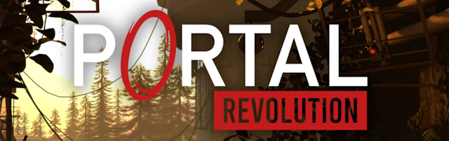

  

    
  

# Portal Revolution VR Mod

VR mod for Portal: Revolution.

## What works
* Stereo view with head tracking; portals, smoke and glass render correctly
* Menu as an overlay in the headset, used with laser pointer or stick
* Walking where the left controller points, snap or smooth turning, jumping, crouching
* Portal gun in the right hand with aim laser or aim dot, shots start at its muzzle
* View turns with the portal when passing through it
* Picking up cubes
* Roomscale: the player follows your head when you walk in your room
* Comfort options, see [If you feel sick](#if-you-feel-sick)
* VR tab in the game's settings, in all languages of the game

## What's missing
* HUD and subtitles
* Videos

Tested with Oculus Touch controllers. The bindings for Index and Vive Cosmos controllers are untested.

## How to use
1. Download [PortalRevolutionVR.zip](https://github.com/stsichler/portal_revolution_vr/releases/latest/download/PortalRevolutionVR.zip) and extract it to `steamapps/common/Portal Revolution`.
2. Start the game with SteamVR. The mod sets the required launch options itself.

To remove the mod, run `Uninstall_Portal_Revolution_VR_Mod.cmd` in the game folder. An update of the mod replaces `VR/config.txt`, so keep a copy if you changed it. An update of the game can break the mod.

Windows Defender can flag `d3d11.dll` as a potential threat. This is a false alarm: the mod takes the place of a system DLL and hooks functions of the game, as malware also does. If it gets blocked, allow it under Windows Security > Virus & threat protection > Protection history, or build the mod yourself from this source code. Only download it from this page.

## Controls
| Oculus Touch | In the game | In the menu |
|---|---|---|
| Left stick | Walk, click to recenter | Navigate |
| Right stick | Turn | |
| Right trigger | Blue portal | Click with the laser, hold to drag |
| Right grip | Orange portal | |
| A | Jump | Select |
| B | Use, pick up | Back |
| Y | Pause menu | Back |
| Left grip | Crouch | |

You can change them in SteamVR's controller bindings.

## Playing left-handed or seated
Change these on the VR tab of the game's settings or in `Portal Revolution/VR/config.txt`.
* `LeftHanded=true`: the portal gun and the buttons change hands.
* `WalkWithRightStick=true`: the right stick walks, the left one turns.
* `SeatedMode=true`: for playing seated, also in a wheelchair. Roomscale keeps working.

## If you feel sick
Change these on the VR tab of the game's settings or in `Portal Revolution/VR/config.txt`, one after the other. They apply at once, no restart needed.
1. `ApplyPitchAndRollPortalRotationOffset=false`: the view stays upright when you pass through a portal.
2. `VignetteWalking=0.8`: darkens the edges of your view while you walk with the stick.
3. Leave `SnapTurning=true`: the view jumps when you turn. With `false` it turns smoothly, and `VignetteTurning` darkens the edges meanwhile.

## Problems
Please [open an issue](https://github.com/stsichler/portal_revolution_vr/issues) right after the game ended and attach `prvr_debug.log` from the game folder. It starts over with each game start. It can contain your Windows user name, so check it first.

## Build instructions
1. Clone the repository
2. Open `portal_revolution_vr.sln`, set to x64 (Debug, Release or RelWithDebInfo), build

After building, `d3d11.dll` is copied to `Portal Revolution/bin/win64` (default Steam path), so the game must not be running. Then `tools/package-release.ps1` makes the ZIP.

## Based on
* Brilliant Portal 2 VR mod from [Gistix](https://github.com/Gistix/portal2vr)
* Portal Reloaded adaptions from [Scriptor25](https://github.com/Scriptor25)
* [l4d2vr](https://github.com/sd805/l4d2vr)
* Development history before Portal Revolution: [portal_reloaded_vr](https://github.com/stsichler/portal_reloaded_vr)
  
## Utilizes code from
* [VirtualFortress2](https://github.com/PinkMilkProductions/VirtualFortress2)
* [gmcl_openvr](https://github.com/Planimeter/gmcl_openvr/)
* [source-sdk-2013](https://github.com/ValveSoftware/source-sdk-2013/)

## License
The mod's code is licensed under the [GNU GPL v3](COPYING), like [portal2vr](https://github.com/Gistix/portal2vr) it is based on. Exceptions:
* `src/sdk/`: Valve's [Source 1 SDK License](src/sdk/LICENSE.txt). It allows distribution only for free, so this mod must stay free of charge.
* The Portal: Revolution logo (`imgs/logo.png`, `package-files/portal_revolution_vr_capsule.png`) isn't covered by the GPL and belongs to the game's makers.
* l4d2vr, VirtualFortress2 and gmcl_openvr state no license; their authors keep their rights. If you are one of them and object to something here, please open an issue.

## Third-party licenses
* [MinHook](https://github.com/TsudaKageyu/minhook): Copyright (C) 2009-2017 Tsuda Kageyu; Hacker Disassembler Engine: Copyright (c) 2008-2009 Vyacheslav Patkov. BSD 2-Clause License, see [thirdparty/minhook/LICENSE.txt](thirdparty/minhook/LICENSE.txt).
* [OpenVR](https://github.com/ValveSoftware/openvr): Copyright (c) 2015, Valve Corporation. BSD 3-Clause License, see [thirdparty/openvr/LICENSE](thirdparty/openvr/LICENSE).
